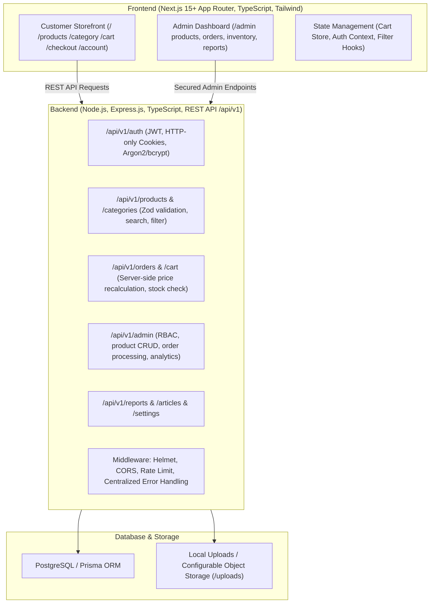

# Krishi Service BD (কৃষি সার্ভিস বিডি) — Implementation Plan & Architecture

## System Architecture

## Step-by-Step Implementation Steps
1. **Scaffold Backend**: Express + TypeScript + Prisma + Zod + JWT + Helmet + CORS + File Uploads.
2. **Database Models (Prisma)**: User, Address, Category, Product, ProductImage, Brand, Cart, CartItem, Order, OrderItem, Payment, InventoryMovement, Banner, Article, StoreSetting.
3. **Seed Data**: Comprehensive realistic Bengali demo catalog (Seeds, Fertilizers, Pesticides, Machinery) with genuine attributes and disclaimer notices.
4. **Backend Controllers & Routes**: Auth, Products, Categories, Cart, Orders, Admin, Reports, Settings.
5. **Scaffold Frontend**: Next.js App Router, Tailwind CSS, Lucide Icons, Hind Siliguri / Bengali typography.
6. **Frontend Storefront**:
   - Header (Announcement bar, search, cart badge, navigation).
   - Hero banner with high-impact visuals and CTA.
   - Category grid & Featured products (New, Best-selling, Special offers).
   - Agricultural advice & seasonal guides section.
   - Product Catalog with filters (categories, price range, brand, stock, sort).
   - Product Details page with gallery, quantity, specs, usage warnings, and related items.
   - Shopping Cart with persistence and real-time total summary.
   - Checkout with BD geographic structure (Village, Union, Upazila, District) and COD / bKash instructions.
7. **Customer & Admin Portals**:
   - Customer login/register, order history & status tracking.
   - Protected Admin Panel at `/admin` (overview metrics, product CRUD, order status workflow, inventory controls).
8. **Testing & Verification**: Unit and integration test suite, build checks, and comprehensive documentation.
